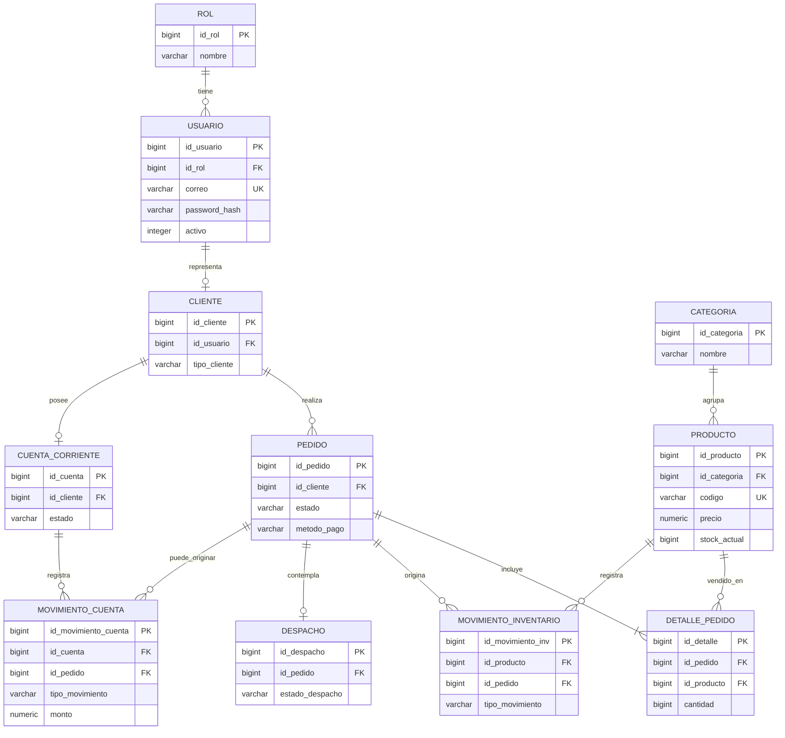
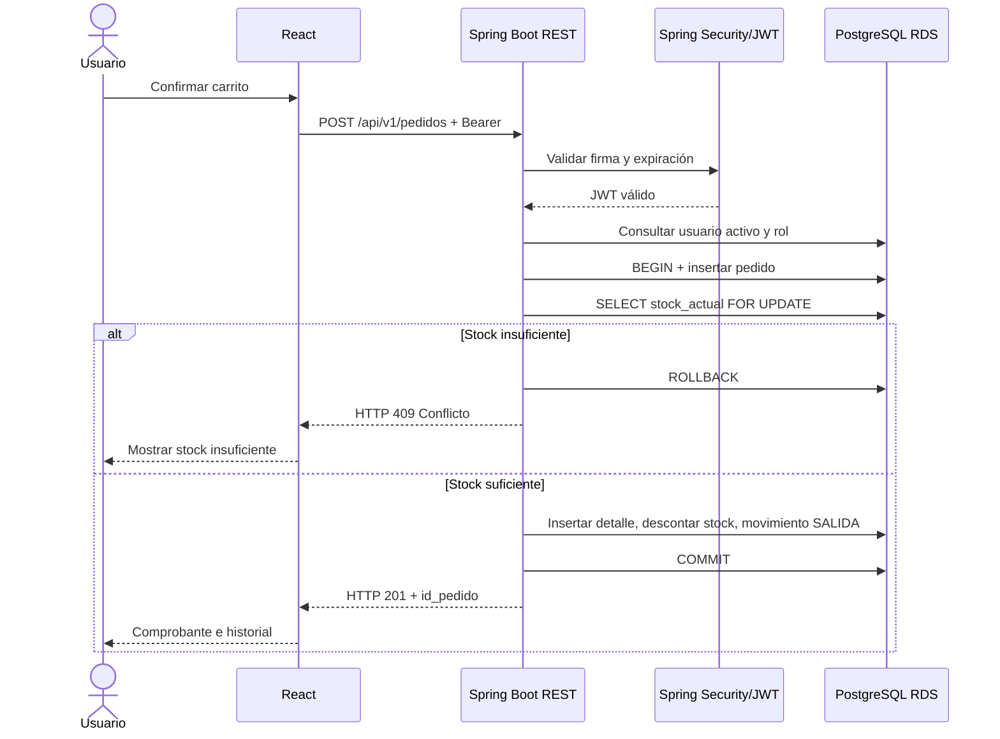

# Ferretería Los Maestros — Backend · Evaluación Parcial 3

**Asignatura:** DSY1104 · Desarrollo Fullstack II · 2026
**Caso:** Ferretería Los Maestros
**Tecnología:** Java (compilación 17 según `pom.xml`), Spring Boot 3.5.8, Spring Security, JDBC, PostgreSQL RDS y Swagger/OpenAPI.
**Estado de fuente:** rama de desarrollo `feature/catalogo-productos`, ZIP revisado el 27/11/2026.

## Repositorios

- [Backend](https://github.com/Tiema2005/evaluacion_ferreteria_clavos_backend)
- [Frontend](https://github.com/Tiema2005/evaluacion_ferreteria_clavos_frontend)

> Las URLs públicas de EC2 pueden cambiar al reiniciar la instancia. Para mostrar el trabajo al docente se debe comprobar la IPv4 pública actual y **desplegar primero las ramas verificadas en el servicio principal**. Los resultados de las pruebas aisladas no garantizan que `main` o `:8080` tengan esta versión.

## Arquitectura

```text
React / Vite (navegador)
     | Axios /api/v1, JWT Bearer
     v
Spring Boot REST + Spring Security (Ubuntu EC2)
     | Servicios + JdbcTemplate + transacciones
     v
PostgreSQL AWS RDS
```

En EC2, Nginx publica la compilación de React. La instancia usada para verificar catálogo/pedidos tiene servicio principal en `8080` y servicio aislado de pruebas en `127.0.0.1:8081`, con configuración propia para `ferreteria_catalogo_test`.

## Modelo y persistencia

El esquema PostgreSQL comprende 11 tablas: `rol`, `usuario`, `categoria`, `producto`, `cliente`, `pedido`, `detalle_pedido`, `movimiento_inventario`, `despacho`, `cuenta_corriente` y `movimiento_cuenta`.

- `usuario.id_rol` → `rol.id_rol`; contraseñas almacenadas con BCrypt.
- `producto.id_categoria` → `categoria.id_categoria`; código único, stock y estado activo.
- `pedido.id_cliente` → `cliente.id_cliente`; líneas en `detalle_pedido`.
- `movimiento_inventario` audita salidas, entradas y ajustes.
- `cuenta_corriente` y `movimiento_cuenta` calculan saldo por cargos menos abonos (módulo adicional pendiente de prueba integral).

## Diagramas y decisiones técnicas (Guía 19)

### Diagrama entidad-relación del dominio



### Diagrama de secuencia: crear pedido y controlar stock



### Decisiones justificadas

- **JDBC y servicios transaccionales:** consultas SQL explícitas, bloqueo `FOR UPDATE` para no vender por encima de stock y reversión automática del pedido ante `409`.
- **JWT + comprobación en RDS:** un token firmado permite verificar la sesión, pero el rol y el estado activo se consultan nuevamente en PostgreSQL para bloquear cuentas desactivadas.
- **Servicio Spring Boot único:** organiza controladores y servicios por responsabilidad y es válido para las tecnologías admitidas por la pauta de esta EP3; no se requiere microservicios/Docker en lo mostrado.
- **Ambientes separados:** `ferreteria_db` para el servicio principal y `ferreteria_catalogo_test` para pruebas sobre el puerto 8081.

## API `/api/v1`

| Recurso | Métodos | Seguridad |
| --- | --- | --- |
| `/auth/registro`, `/auth/login` | POST | Público; registro crea rol CLIENTE |
| `/auth/me` | GET | JWT válido, usuario activo |
| `/usuarios`, `/usuarios/{id}` | GET, POST, PUT, DELETE | CRUD restringido por rol y titularidad |
| `/categorias` | GET | Público |
| `/productos`, `/productos/{id}` | GET, POST, PUT, DELETE | GET público, cambios Admin |
| `/productos/gestion` | GET | Admin/Vendedor |
| `/productos/{id}/stock` | PUT | Admin/Vendedor |
| `/pedidos`, `/pedidos/{id}` | GET, POST, DELETE | Clientes ven lo propio; gestor ve todos |
| `/pedidos/{id}/estado` | PUT | Admin/Vendedor |
| `/cuenta-corriente/mi-cuenta` | GET | Contratista |
| `/cuenta-corriente/admin` y rutas de habilitación/abono | GET, POST | Admin; adicional |

Swagger UI: `/swagger-ui/index.html` — OpenAPI JSON: `/v3/api-docs`. Comprobar IP/puerto reales antes de incluir enlaces públicos.

## Reglas de negocio y seguridad

- Tokens JWT HS256 con emisor `ferreteria-los-maestros` y **vigencia de una hora** (`TokenUsuarios.java`).
- `UsuariosService.usuarioActual` reconsulta el rol y estado del usuario en PostgreSQL. No basta con ocultar botones en React.
- Sin token válido: HTTP **401**; autenticado sin permisos: **403**; faltan recursos: **404**.
- Pedido con stock insuficiente: **409**, con transacción que revierte pedido y descuento; stock bloqueado mediante `SELECT ... FOR UPDATE`.
- Clientes y contratistas solo consultan sus pedidos; vendedores y administradores gestionan estados.
- Cancelación de pedido devuelve unidades y registra movimiento de entrada si está permitida.
- La clave `JWT_SECRET` debe ser hexadecimal de 64 caracteres y estar fuera del repositorio.

## Evidencia comprobada en la base aislada (27/11)

| Caso | Resultado |
| --- | --- |
| Registro/login y sesiones | HTTP 201/200; `/auth/me` revalida usuarios activos |
| Catálogo | 85 importados + dos ficticios: 87 totales, 86 activos |
| Compra #4 | Martillo `TEST-001`, 1 unidad, stock 20→19 |
| Compra #5 | Cemento `MC001`, 1 unidad, stock 80→79; estado `ENTREGADO` |
| Stock excesivo | HTTP 409, stock 79→79, sin nuevo pedido |
| Permisos de contratista | 403 al consultar pedido ajeno, gestionar estados o inventario |
| Frontend | Compilación Vite y 46/46 pruebas Vitest reportadas |
| Cuenta corriente | Código compilado; pendiente cargo/abono end-to-end |

**No hay tests JUnit en el ZIP revisado** (no aparece `src/test`). Las verificaciones de API descritas fueron manuales/integración, no tests automatizados de backend.

## Compilar y ejecutar

```bash
mvn clean package -DskipTests
# Variables requeridas en el entorno (sin publicar valores):
# DB_URL, DB_USER, DB_PASSWORD, JWT_SECRET y opcional CORS_ORIGINS
java -jar target/ferreteria-los-maestros-backend-0.1.0-SNAPSHOT.jar --server.port=8081 --server.address=127.0.0.1
```

**Atención:** arrancar solo con variables de una base aislada. No sobreescribir `ferreteria.service`, el JAR principal ni `.env` de producción mientras se prueba.

## Documentos de EP3

- [ERS actualizada](docs/ERS_Actualizada_EP3.docx)
- [Documento de integración](docs/Documento_Integracion_EP3.docx)

## Pendiente antes del AVA

1. Confirmar merge de ambas ramas y ejecución de la versión final en el entorno de demostración.
2. Repetir validación en la URL pública real de Nginx/Swagger (sin compartir contraseñas ni JWT).
3. Completar las capturas exigidas y dejar los ZIP sin `target`, `node_modules` ni `dist`.
4. Probar cargos y abonos de cuenta corriente antes de declararla lista.
